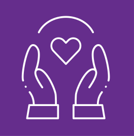
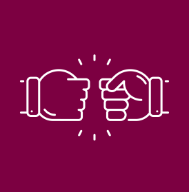
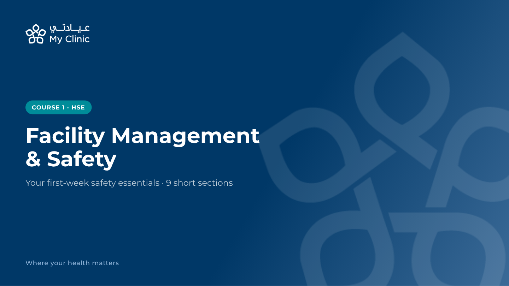
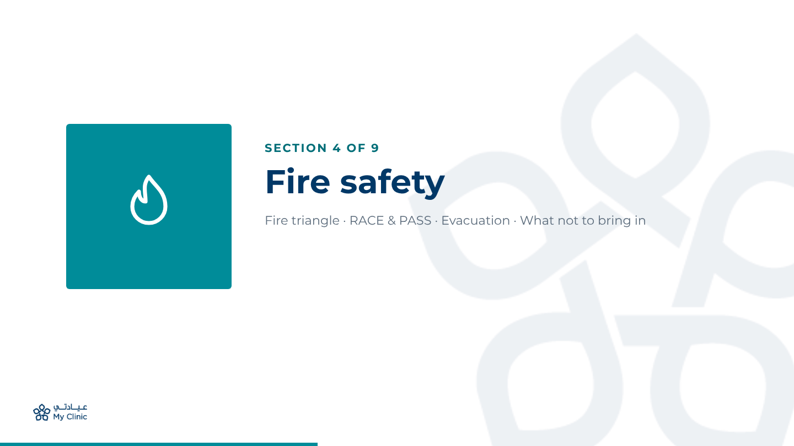
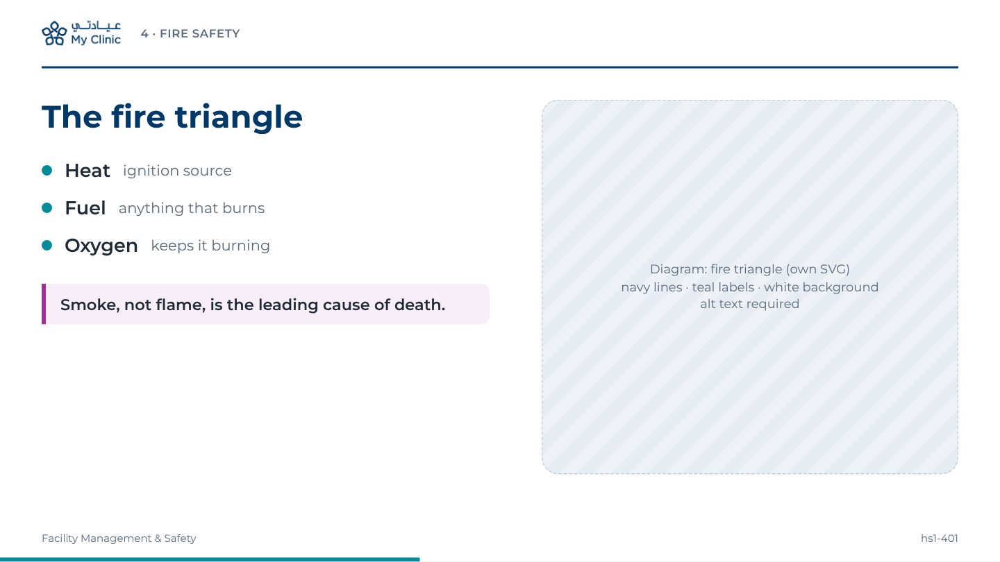
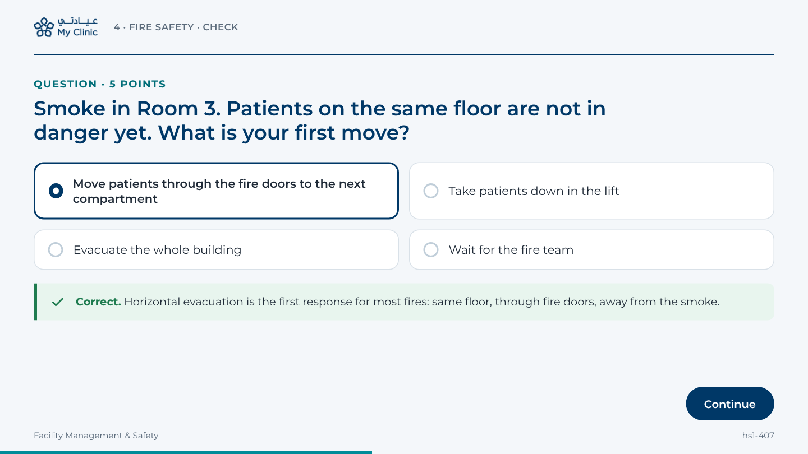
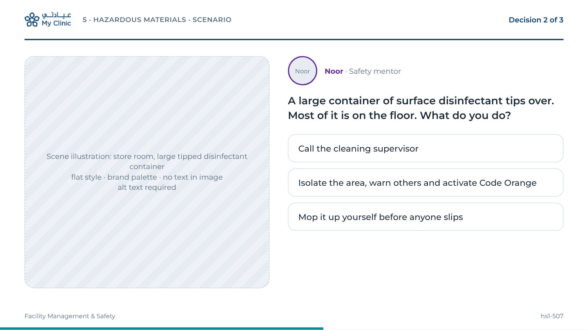
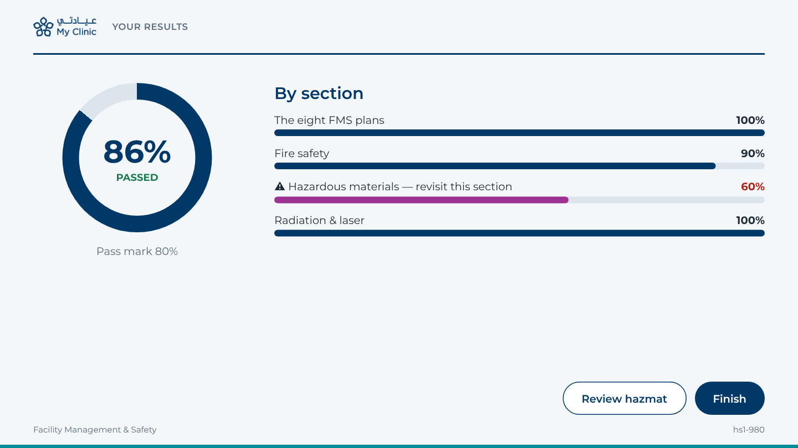

# My Clinic (عيادتي) brand identity for e-learning


**Read this before you design, generate or describe any screen, image, icon or character.** It is the single source of truth for how the My Clinic courses look. Every storyboard card and every generated asset must follow it.

> **Source and status.** The logo, colours, font and graphic elements below were taken from My Clinic's own official decks in the course folder: `HR.pptx` (Employee Induction, company template) and `Operations & My Care Structure.pptx`. Colours were sampled from the original image files. They are **ready to use**, but Marketing should confirm them against the official brand guide (decision D11 in `../cross-module-decisions.md`). If Marketing sends different values, change them **only here** and in `brand-kit.json`.

---

## 1. The logo

| File | Use it on | Preview |
|---|---|---|
| [`assets/logo-horizontal-navy.png`](assets/logo-horizontal-navy.png) | White or light backgrounds (all content, question, scenario and results screens) |  |
| [`assets/logo-horizontal-white.png`](assets/logo-horizontal-white.png) | Navy backgrounds (title screen, closing screen) | on navy only |
| [`assets/logo-horizontal-on-navy.png`](assets/logo-horizontal-on-navy.png) | Where a solid navy logo block is needed (e.g. a badge, a certificate) |  |
| [`assets/mark-navy.png`](assets/mark-navy.png) / [`assets/mark-white.png`](assets/mark-white.png) | The five-petal mark alone: favicon-size uses and the **watermark** |  |

The logo is a **lock-up**: the five-petal mark + Arabic wordmark **عيادتي** + English wordmark **My Clinic**. The tagline used in the decks is **"Where your health matters"**.

### Rules

1. **Never redraw, re-type or AI-generate the logo.** Always place the supplied PNG files. Image models must never be asked to draw the logo or the words "My Clinic".
2. Only two colourways: **navy on light**, **white on navy**. Never place it on teal, purple, magenta or burgundy, on a photo, or on a busy illustration.
3. **Clear space** around the logo = the height of one petal (about ¼ of the logo height). Nothing else inside that space.
4. **Minimum size** on the 960 × 540 stage: **26 px tall** (header), **48 px tall** (title screen).
5. Do not stretch, rotate, outline, shadow, crop or recolour it. Do not separate the Arabic and English wordmarks.
6. **One logo per screen.** The watermark mark does not count as a logo.

### Where the logo goes on each screen

| Screen | Logo | Position |
|---|---|---|
| Title (course cover) | `logo-horizontal-white.png`, 48 px tall | Top-left, 48 px from left and 40 px from top |
| Section opener | `logo-horizontal-navy.png`, 26 px tall | Bottom-left, 40 px from left, 28 px from bottom |
| Content, question, scenario, results | `logo-horizontal-navy.png`, 30 px tall | Header, top-left, 40 px from left, vertically centred in the 64 px header |
| Closing / summary | `logo-horizontal-navy.png` (light background) or white (navy background) | Header or top-left as above |

The edumints player adds its own control bar; the logo sits inside the course stage, never over the player controls.

---

## 2. Colour palette

   

| Token | Hex | Name / meaning | Role in the courses | Contrast (on white) |
|---|---|---|---|---|
| `navy` | **#003867** | My Clinic Navy (logo, title backgrounds) | Primary: titles, headings, header rule, buttons, progress, logo | 11.9 : 1 ✅ any text |
| `caring` | **#652D8C** | Purple — value *Caring* | Mentor character accent, HR course identity | 9.1 : 1 ✅ any text |
| `ambitious` | **#008C99** | Teal — value *Ambitious* | Tiles, chips, bullets, icons, large text only | 4.0 : 1 ⚠ large/bold text and graphics only |
| `ambitious-dark` | **#006E78** | Darker teal (derived for text) | Small teal text: labels, "SECTION 4 OF 9", links | 6.0 : 1 ✅ any text |
| `responsible` | **#9D3293** | Magenta — value *Responsible* | **Accent**: key warnings, key numbers, callout bars | 6.3 : 1 ✅ any text |
| `collaborative` | **#7C0041** | Burgundy — value *Collaborative* | RCM course identity, strong emphasis | 10.9 : 1 ✅ any text |
| `lilac` | #946CAF | Light purple (values slide) | Decorative tints only | 4.2 : 1 ⚠ graphics only |
| `ink` | #1F2A37 | Body text | All body text | 14.5 : 1 ✅ |
| `muted` | #5B6B7B | Secondary text | Captions, footers, helper text | 5.5 : 1 ✅ |
| `mist` | #C0CED9 | Blue-grey from the logo | Placeholder borders, track of progress bars, subtitle on navy | text on navy only (7.4 : 1) |
| `bg` | #F4F7FA | Off-white page | Background of question and results screens | — |
| `surface` | #FFFFFF | White | Content screens, cards | — |
| `line` | #D9E1E8 | Divider | Card borders, table lines | — |
| `success` | #1E7B4F | Feedback green (not a brand colour) | Correct-answer feedback only, always with ✓ icon and the word "Correct" | 5.3 : 1 ✅ |
| `error` | #B42318 | Feedback red (not a brand colour) | Wrong-answer feedback, weak results; always with icon and words | 6.6 : 1 ✅ |

### Colour rules

- **60-30-10:** about 60% white/off-white, 30% navy, 10% one value colour (the module colour, below) plus magenta for warnings.
- **White text** is allowed on navy, purple, magenta and burgundy. On teal, white text must be **≥ 18.7 px bold or ≥ 24 px regular** (contrast 4.0 : 1).
- **Emergency-code colours** (Code Red, Orange, Blue…) are *content*, not brand colours. Show them only as small colour chips next to the printed code name.
- **Never use colour alone** to carry meaning (correct/incorrect, risk bands, NFPA quadrants, waste bins). Add text, an icon or position.
- No gradients except the navy title gradient (#003867 → #3B6A97). No neon, no pure black, no drop shadows heavier than the mockups.

### Module identity colours

Each course gets one value colour for its chips, section tiles, bullets and progress bar. Navy stays the main colour everywhere.

| Course / package | Module colour | Why |
|---|---|---|
| 01 + 02 Health, Safety & Environment | `ambitious` teal #008C99 | Fresh, safety-signage feel, distinct from Code Red/Orange |
| 03 Welcome On Board (HR) | `caring` purple #652D8C | People and belonging |
| 04 Operations & My Care | `responsible` magenta #9D3293 | Ownership of the patient journey |
| 05 + 06 RCM | `collaborative` burgundy #7C0041 | Serious, professional, finance |
| 07 Clinical Governance | `caring` purple #652D8C | Patient care and safety culture |
| 08 IT / EHR | `ambitious-dark` teal #006E78 | Systems, calm and technical |

---

## 3. Typography

| Use | Font | Weight | Size on 960 × 540 stage |
|---|---|---|---|
| Course title (title screen) | **Montserrat** | Bold 700 | 40 px |
| Section title | Montserrat | Bold 700 | 40 px |
| Screen title (h1) | Montserrat | Bold 700 | 28–30 px |
| Question stem / subheading (h2) | Montserrat | SemiBold 600 | 20–24 px |
| Body and options | Montserrat | Regular 400 / Medium 500 | 14–18 px (never below 14 px) |
| Labels, chips, breadcrumbs | Montserrat | Bold 700, uppercase, +0.08em tracking | 11–14 px |
| Captions, footer | Montserrat | Regular 400 | 10–12 px (footer only) |
| Arabic text (release 2, bilingual code cards) | **Tajawal** (proposed; confirm with Marketing) | 400 / 700 | same sizes |

Montserrat is the font used throughout My Clinic's official decks. It is free (SIL Open Font Licence) and can be embedded in the SCORM package with `custom_fonts`. Fallback stack: `'Montserrat', 'Segoe UI', Roboto, Arial, sans-serif`.

Sentence case for titles ("The fire triangle"), not Title Case. Numbers as digits.

---

## 4. Graphic elements (from the official decks)

| Element | How it looks | Where to use |
|---|---|---|
| **Petal watermark** | The five-petal mark, `mark-navy.png` at 6–8% opacity on light backgrounds or `mark-white.png` at 8–10% on navy, very large (400–520 px), cropped off the right edge | Title, section openers, closing screen only. Never behind body text or questions. |
| **Header rule** | 2 px navy line under a 64 px header, 40 px side margins | Every content, question, scenario and results screen |
| **Value tile** | Solid square in a value colour with one **white line icon** in the centre (see `assets/value-tile-*.png`) | Section openers (module colour), values screens in the HR course, icon grids |
| **Cards** | White, 1 px `line` border, 12 px radius, no or very soft shadow | Options, choices, info panels |
| **Callout bar** | 4 px left bar in magenta + light tint background | One key warning or rule per screen at most |
| **Chips** | Pill shape, module colour, white uppercase bold text | Course/section labels on title and question screens |
| **Buttons** | Pill shape, navy fill, white text; secondary = white with navy outline | Continue, Check, Finish |
| **Progress bar** | 4 px bar at the bottom of the stage in the module colour | All screens except the title |

---

## 5. Icons

- **Style:** single-weight **line icons**, rounded ends, no fills, 24 px grid, stroke ≈ 1.5 px at 24 px. White on colour tiles; navy or module colour on white.
- Match the official value icons (hands-and-heart, rocket, key, fist-bump in `assets/value-tile-*.png`).
- **Source:** draw your own SVG, or use a CC0/public-domain icon set and record the provenance (edumints only accepts `own`, `ai-generated`, `cc0`, `public-domain`, `local`). Do **not** use MIT/ISC/CC-BY icon sets without approval.
- One icon family across all eight packages.

---

## 6. Illustrations, photos and characters

### Style in one sentence

**Clean, flat vector illustration in the My Clinic palette — navy outlines and shapes, white space, one value colour as the highlight, soft blue-grey (#C0CED9) for secondary shapes, no gradients, no text inside the image.**

### What to use for what

| Need | Use | Never |
|---|---|---|
| Diagrams (fire triangle, NFPA diamond, risk matrix, org charts, processes) | **Own SVG** with real text labels, via `svg_to_asset` | AI image generation (it garbles labels and numbers) |
| Scenes for scenarios (corridor, store room, consultation room) | AI-generated flat illustration from the prompt template below, reviewed by a human | Photoreal AI people, stock clichés |
| Equipment (extinguisher, eyewash, spill kits, pumps) | My Clinic's **own photos** (with permission) or flat illustration | Photos from the internet |
| Software screens (Oracle, EHR) | Real screenshots from **test accounts** only | Any screenshot with real names, MRNs, phones or IDs |
| People | The approved mentor character `mentor-noor` and `newstarter-faisal` | Real staff likeness without written consent |

### AI image prompt template (copy, then fill the `{…}` parts)

```text
Flat vector illustration for a healthcare e-learning course, 16:9, {SCENE: e.g. "a clinic corridor
with a fire extinguisher, a manual call point and fire doors"}. Clean minimalist style, simple
geometric shapes, thin navy (#003867) outlines, white and very light blue-grey (#F4F7FA, #C0CED9)
surfaces, one highlight colour {MODULE COLOUR HEX, e.g. teal #008C99}, small touches of magenta
(#9D3293) only for {WARNING ELEMENT or "nothing"}. Modern Saudi outpatient clinic interior, bright and
calm, lots of white space, soft even lighting, no shadows or very soft flat shadows.
{PEOPLE: "no people" | "Noor, the safety mentor (see character sheet)" | "one staff member seen from
behind"}. Modest, culturally appropriate clothing for Saudi Arabia.
No text, no letters, no numbers, no logos, no signage words, no watermarks, no brand names.
```

**Negative prompt / avoid:** photorealism, 3D render, gradients, neon colours, clutter, text, logos, extra hazards not in the brief, blood or injury, distorted hands, Western hospital stereotypes, dark or dramatic lighting.

After generating: check that **only the elements in the brief** appear (very important for hazard-spotting scenes), that nothing in the image looks like text, and that the colours match. Regenerate or edit until it passes. Record the prompt, tool and date in the asset's provenance note.

### Mentor character (`mentor-noor`)

- Fictional senior nurse and safety liaison, Saudi woman in her 30s, **navy scrubs**, white lab coat optional, **plain navy hijab**, plain ID badge with **no logo and no text**, warm calm expression.
- Same flat style as the scenes; navy outline; purple (`caring` #652D8C) as her accent colour (badge lanyard).
- Make **one master image first**, get it approved, then create poses (neutral, explaining, concern, success, hint) from that master.
- Shown as a circular avatar (48–64 px) with a purple ring on scenario screens, or half-body on intro screens. Never on every screen.

---

## 7. Screen layouts

All screens are designed for the edumints **960 × 540 stage** (16:9). Side margins **40 px**, header **64 px**, footer text 16 px from the bottom, progress bar 4 px at the very bottom. The player reflows to a single column on phones, so keep a clear reading order: title → body → media → interaction.

Reference mockups (rendered from [`screen-mockups/mockups.html`](screen-mockups/mockups.html)):

| Layout | Mockup | Use for edumints types |
|---|---|---|
| **L1 Title** |  | `title_slide` (course cover) |
| **L2 Section opener** |  | `content_slide` (`full_media`) at the start of each section |
| **L3 Content** |  | `content_slide`, `accordion`, `tabs`, `flashcards`, `timeline`, `labeled_diagram` (display), `hotspot` (explore), `image_compare`, `worked_example`, `video` |
| **L4 Question** |  | `mcq`, `true_false`, `fill_blank`, `matching`, `sorting`, `drag_drop`, `labeled_diagram` (quiz), `hotspot` (quiz), `poll`, `adaptive_practice` |
| **L5 Scenario** |  | `decision_scenario`, `game`, `escape_room`, `simulation` (screenshot replaces the illustration) |
| **L6 Results / close** |  | `results_breakdown`, `summary` |

### Layout specs

| Layout | Background | Header | Main area | Imagery |
|---|---|---|---|---|
| L1 Title | Navy gradient #003867 → #3B6A97 + white petal watermark right | White logo top-left | Module chip, course title (white, 40 px bold), subtitle (`mist`), tagline bottom-left | None besides watermark |
| L2 Section opener | White + navy petal watermark right | None (logo bottom-left) | 200 px value tile in module colour with white line icon (left), "SECTION n OF N" (ambitious-dark), section title 40 px navy, 3–5 keywords | Icon only |
| L3 Content | White | Navy logo + breadcrumb + navy rule | Left ≈ 45%: title + keywords (≤ 45 words) + optional magenta callout; right ≈ 45%: one diagram/illustration in a 16 px-radius frame | One image max |
| L4 Question | Off-white `bg` | Navy logo + breadcrumb ("Section · Check") + rule | "QUESTION · n POINTS" label, stem (h2), options as cards (2 × 2 grid for short options, 1 column for long), feedback banner with icon + text, navy "Continue" bottom-right | Optional small image above options |
| L5 Scenario | White | Navy logo + breadcrumb + rule + "Decision n of N" (right) | Left ≈ 42%: scene illustration or screenshot; right: mentor avatar, situation (17 px semibold), choices as full-width cards | One scene per node |
| L6 Results | Off-white `bg` | Navy logo + "Your results" + rule | Score ring (navy) with PASSED/NOT YET in words, one bar per objective, weak ones flagged ⚠ + text, buttons | None |

The edumints player draws the real controls, menus and interactions; the mockups show the **visual target** (colours, spacing, hierarchy). The theme tokens in `brand-kit.json` carry the colours and fonts into the player.

---

## 8. Theme for edumints

1. `brand_to_theme(brand)` with [`brand-kit.json`](brand-kit.json).
2. Combine with the `style-minimal` preset.
3. Check the contrast report: teal (#008C99) will be flagged for small text — that's expected; use `ambitious-dark` for small teal text.
4. `set_theme(project_id, theme_tokens)` for every project, then set the module colour as the `secondary` role for that project.
5. Upload Montserrat (OFL) as a custom font so the package does not depend on Google Fonts at runtime.

---

## 9. Do and don't

| Do | Don't |
|---|---|
| Use the supplied logo files exactly | Ask an image model to draw the logo or write "My Clinic" |
| Keep lots of white space; one idea per screen | Fill the screen with icons, stickers or decorative shapes |
| Use navy for structure and one module colour for highlights | Use all four value colours on one screen |
| Put real text in HTML; keep images text-free | Bake titles, labels or numbers into images |
| Use the petal watermark on title/section/close screens only | Put the watermark behind questions or body text |
| Show feedback with icon + words + colour | Rely on green/red alone |
| Use fictional, culturally appropriate people | Use real staff or patients, or stock-photo clichés |

---

## 10. Brand checklist for every screen (agent)

- [ ] Layout L1–L6 chosen and named in the card
- [ ] Correct logo file, size and position for that layout
- [ ] Colours only from the palette; module colour as the single highlight; magenta only for warnings/key numbers
- [ ] Text contrast rules met (no small white text on teal; no small teal text on white)
- [ ] Montserrat sizes within the table; nothing below 14 px except the footer
- [ ] Watermark only on L1, L2 or closing screens
- [ ] Images follow the style sentence; AI images used the prompt template and contain no text or logos
- [ ] Icons are line icons from one family, with provenance
