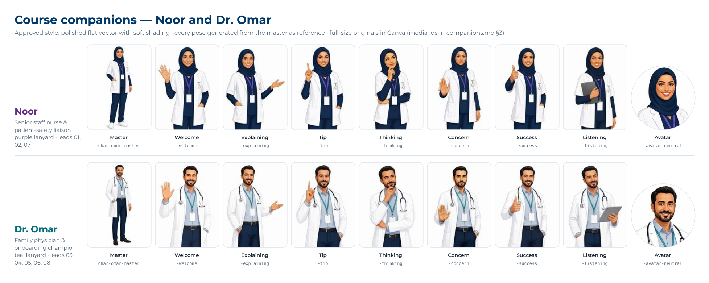

# Course companions: Noor and Dr. Omar


Two fictional My Clinic colleagues guide every trainee through all eight packages. They welcome learners, explain why things matter, give short tips, share honest "my first year" stories, react to the learner's choices in scenarios, and close each course. They make the courses feel like a colleague is walking beside you on your first week.

This file is the **character bible**. It is mandatory for anyone (person or AI agent) who writes storyboards, narration, image prompts or audio for the courses. It sits with the brand guide: [`../brand/brand-identity.md`](../brand/brand-identity.md).



*Character sheet: master + 7 poses + avatar for each companion, generated from the master as reference so face, outfit and style stay identical. Previews here are low resolution; the full-size originals (1088 × 1456 px) are in My Clinic's Canva account — media ids in §3.*

---

## 1. Who they are

| | **Noor** | **Dr. Omar** |
|---|---|---|
| Id (used in plans, assets, scripts) | `noor` | `omar` |
| Role in the story | Senior staff nurse and patient-safety liaison at My Clinic J1. Ten years at the clinic. | Family physician at My Clinic J2 and the clinic's onboarding and digital champion. Joined six years ago. |
| Age | Mid-30s | Late 30s |
| What she / he cares about | Patient safety, doing things right first time, looking after colleagues | Making the system easy for new people, good documentation, patients getting what they need |
| Personality | Calm, warm, precise; quietly funny; firm when safety is at stake | Friendly, practical, curious; a little self-deprecating about paperwork; encouraging |
| How they speak | Short, clear sentences; "Let's…", "Here's the thing…"; never preachy | Conversational; "Honestly…", "Here's what helped me…"; explains the *why* |
| Signature colour (accent only) | Caring purple **#652D8C** (lanyard, avatar ring, tip card edge) | Ambitious teal **#008C99** (lanyard, avatar ring, tip card edge) |
| Lead host of | 01 HSE Part 1 · 02 HSE Lab · 07 Clinical Governance | 03 HR · 04 Operations & My Care · 05 RCM A · 06 RCM B · 08 EHR |
| Co-host of | 03, 04, 05, 06, 08 | 01, 02, 07 |

They are **fictional**. They must never look like, be named after, or be voiced by a real My Clinic employee without written consent. Names are spoken "Noor" (rhymes with *tour*) and "OH-mar".

### Their honest stories (human vulnerability)

Short, true-to-life moments the companions share once each, to make it safe for learners to admit what they don't know. Use each story **once** in the programme, on the screen listed. Keep them to two sentences; never dramatise patient harm.

| Character | Story (line to use or adapt) | Where |
|---|---|---|
| Noor | "On my first day I couldn't have told you where the nearest call point was. Now it's the first thing I check in any new area." | `hs1-001` |
| Noor | "I walked past a blocked fire exit for a week before I noticed it. Hazards hide in plain sight." | `hs2-011` |
| Noor | "I once nearly drew blood from the wrong Mr Al-Harbi. The wristband stopped me — that's why we never skip it." | `qsr-021` |
| Noor | "Most of us have stayed quiet about something unsafe at least once. I have. Speaking up gets easier every time." | `qsr-002` |
| Omar | "My first week here, I felt there was too much to take in. You don't need to remember everything today — just where to find it." | `hr-001` |
| Omar | "I once sent the same patient to three different desks in one morning. She never forgot it, and neither did I." | `ops-001` |
| Omar | "Nobody taught me documentation for insurance at medical school. My first month, a lot of my claims came back." | `rcma-001` |
| Omar | "The first time I read our rejection log, I recognised two of my own claims." | `rcmb-050` |
| Omar | "My first week, I typed 'diabetes' and picked the first line. It wasn't the diagnosis I meant." | `ehr-020` |

---

## 2. How they look (visual bible)

**Approved style:** polished flat vector illustration with **subtle soft shading**, like a premium explainer-video character; clean confident linework; semi-realistic proportions (about 7 heads tall); friendly and professional — **not** cartoon, chibi or photoreal. Limited palette: navy, white, the character's accent colour, warm skin tones. (Characters are the one place where soft shading is allowed; scenes and diagrams stay flat.)

| | **Noor** | **Dr. Omar** |
|---|---|---|
| Face | Oval face, warm medium-brown skin, dark brown eyes, soft natural smile, light eyebrows | Slightly square face, light-medium brown skin, dark eyes, short neat black beard, warm smile |
| Hair / head | Plain **navy hijab** (#003867), neatly wrapped, no pattern | Short dark hair, tidy |
| Clothing | **Navy scrubs** (#003867) with a short white open lab coat; plain white undershirt sleeves; flat white shoes | **White doctor's coat** over a light blue-grey shirt (#C0CED9) and navy trousers (#003867); dark shoes |
| Props | Fob watch on the coat; small clipboard or tablet in some poses | Stethoscope around the neck; tablet in some poses |
| Badge | Plain white ID badge on a **purple lanyard** (#652D8C). **No logo, no text, no photo on the badge.** | Plain white ID badge on a **teal lanyard** (#008C99). **No logo, no text, no photo.** |
| Build / height | Medium height, slim-average build | Slightly taller, average build |
| Never | Jewellery beyond a plain watch; makeup-heavy look; Western-style uniform caps | Ghutra/shemagh in clinical scenes; sunglasses; casual T-shirts |

### Consistency rules

1. The **master image of each character is done** (`char-noor-master`, `char-omar-master`). Confirm approval in Phase 3. Every other pose is generated **from that master** (image reference / character reference / same seed), not from a fresh prompt.
2. Keep face, skin tone, hijab/hair, clothing, lanyard colour and proportions identical in every pose.
3. Check every pose at the size it will be shown (64 px avatar and 300–420 px half-body), next to the master, before accepting it.
4. Transparent background (PNG with alpha), no shadow on the ground, no props that are not in the list.
5. Mirror (flip) a pose only if nothing asymmetric breaks (badge side may flip; that is acceptable).

---

## 3. Asset list (program-wide, shared by all modules)

**Status: masters and 7 poses + avatar per character are generated** (Canva AI, 14 Oct 2026). The full-size files live in My Clinic's Canva account; open each with `https://www.canva.com/M/<media id>` and download as **PNG with transparent background** (Canva Pro background remover) into `00_program/characters/assets/<asset id>.png`. Low-resolution previews are in [`previews/`](previews/). Provenance: `ai-generated` (Canva AI, prompts below), reviewed for consistency.

| Asset id | Noor — Canva media id | Dr. Omar — Canva media id | Use |
|---|---|---|---|
| `char-<id>-master` | `MAHX-pdlawM` | `MAHX-ka2O4Q` | Reference only (full body, 3/4 view) — every pose is generated from this |
| `char-<id>-welcome` | `MAHX-pFaNMU` | `MAHX-hEFOR4` | Open-palm wave — title / intro / "meet your guides" |
| `char-<id>-explaining` | `MAHX-hqkU5I` | `MAHX-ljvFtE` | Hand presenting to the side — content screens, scenario intros |
| `char-<id>-tip` | `MAHX-v-F8xI` | `MAHX-jYQR58` | Index finger raised — tip cards |
| `char-<id>-thinking` | `MAHX-p0nWpE` | `MAHX-jgu1Vk` | Hand at chin — worked examples |
| `char-<id>-concern` | `MAHX-hFE0aQ` | `MAHX-nCzJ70` | Raised palm, serious — warnings, unsafe choices |
| `char-<id>-success` | `MAHX-jiR90M` | `MAHX-llCU5M` | Thumbs up — correct choices, results, close |
| `char-<id>-listening` | `MAHX-v3i0kY` | `MAHX-uifxtY` | Holding a tablet, attentive — polls, reflections |
| `char-<id>-avatar-neutral` | `MAHX-n4HuyU` | `MAHX-nPHDkA` | Head and shoulders, square — crop to a circle for 48–64 px avatars |
| `char-<id>-avatar-happy` / `-avatar-concern` | to make if needed | to make if needed | Crop from `-success` / `-concern`, or generate from the avatar with the pose prompt |
| `char-duo-welcome` | — | — | Not needed as one image: place the two `-welcome` poses side by side (see mockup 07) |

| | Noor | Dr. Omar |
|---|---|---|
| Preview |  |  |

Sizes in the course: half-body 300–420 px tall; avatars 48–64 px. Export at 1088 × 1456 (poses) and 1024 × 1024 (avatars).

### AI prompts actually used (Canva AI image generator)

Master images were made with these prompts (text-to-image, portrait 3:4):

**Noor (master):**
```text
Professional character design for a corporate healthcare e-learning course, high-quality modern flat
vector illustration with subtle soft shading, polished like a premium explainer-video character. Full
body, three-quarter view, standing relaxed and confident, warm friendly smile, on a plain white
background. A Saudi woman in her mid-30s, a senior staff nurse:
oval face, warm medium-brown skin, dark brown eyes, soft natural smile, plain navy (#003867) hijab
neatly wrapped, navy scrubs with a short white open lab coat, fob watch pinned to the coat, plain
white ID badge on a purple (#652D8C) lanyard with nothing printed on the badge, flat white shoes.
Clean minimalist style, thin navy (#003867) outlines, simple shapes, flat colours, no gradients,
semi-realistic proportions about 6.5 heads tall, friendly and professional, culturally appropriate
for Saudi Arabia. No text, no letters, no logos, no watermark, no background scene, no shadow.
```

**Dr. Omar (master):**
```text
Professional character design for a corporate healthcare e-learning course, high-quality modern flat
vector illustration with subtle soft shading, polished like a premium explainer-video character. Full
body, three-quarter view, standing relaxed and confident, warm friendly smile, on a plain white
background. A Saudi man in his late 30s, a family physician:
slightly square face, light-medium brown skin, dark eyes, short neat black beard, short tidy dark
hair, warm smile, white doctor's coat over a light blue-grey (#C0CED9) shirt and navy (#003867)
trousers, stethoscope around the neck, plain white ID badge on a teal (#008C99) lanyard with nothing
printed on the badge, dark shoes. Clean minimalist style, thin navy (#003867) outlines, simple
shapes, flat colours, no gradients, semi-realistic proportions about 6.5 heads tall, friendly and
professional, culturally appropriate for Saudi Arabia. No text, no letters, no logos, no watermark,
no background scene, no shadow.
```

### AI prompt — poses (image-to-image, the approved master attached as the reference image)

Used for every pose; only the `{POSE}` sentence changes. In Canva: generate-image with the master's media id as the image reference.

```text
Same character as the reference image: identical face, skin tone, {navy hijab, navy scrubs, short white
open lab coat, fob watch, blank white badge on purple lanyard | short neat black beard, white doctor's
coat over light blue-grey shirt, navy trousers, stethoscope, blank white badge on teal lanyard}, same
polished flat vector illustration style with soft shading. Plain white background. {POSE}: e.g. "half-body, open palm wave, big friendly smile" /
"half-body, right hand gesturing to the left side as if presenting something" / "half-body, index
finger raised, giving a friendly tip" / "half-body, serious caring expression, palm slightly raised" /
"half-body, thumbs up, big smile" / "head and shoulders only, centred, for a circular avatar, {neutral |
smiling | concerned} expression". Transparent background. No text, no letters, no logos, no badge
printing, no extra props, no shadow.
```

**Negative / avoid:** photorealism, 3D, anime/chibi, different face between poses, text on the badge, logos, extra jewellery, Western nurse cap, ghutra in clinic, dramatic lighting, background scenery.

---

## 4. Where they appear on screen (visual plan rules)

Follow the brand layouts L1–L6 ([`../brand/brand-identity.md`](../brand/brand-identity.md) §7). Mockups: [`../brand/screen-mockups/07-meet-your-guides.png`](../brand/screen-mockups/07-meet-your-guides.png) and [`08-companion-tip.png`](../brand/screen-mockups/08-companion-tip.png).

| Layout | Companion use | Size and position |
|---|---|---|
| L1 Title | Lead host `welcome` pose (both `welcome` poses on `hr-000`, the first course in the path) | On the navy background, show the character in a **white rounded portrait card** (16 px radius, 4 px top edge in the character colour, name + role under the image), about 190 × 300 px, right side (mockup 07). Use a free-standing cut-out only if you have a clean transparent PNG from Canva's background remover — never a rough cut-out on navy |
| L2 Section opener | None (the value tile carries the screen) | — |
| L3 Content | (a) **Intro screens**: half-body `explaining` pose in the right column instead of an illustration. (b) **Tip card**: avatar + speech card | (a) 320–380 px tall, right column. (b) 56 px avatar with a 3 px ring in the character colour, card 360 px wide max, bottom-left, white card with 4 px left edge in the character colour, ≤ 25 words, label "Noor's tip" / "Omar's tip" |
| L4 Question | **Not visible while the learner answers.** May appear in the feedback banner as an avatar (`avatar-happy` correct / `avatar-concern` incorrect) | 40 px avatar at the left of the feedback banner |
| L5 Scenario | Avatar with name and role above the situation; pose/avatar changes with the outcome | 48–64 px avatar, ring in character colour, "Noor · Safety liaison" / "Dr. Omar · Family physician" |
| L6 Results / close | Lead host `success` pose with a one-line closing message; both for the final summary of a module | Half-body 300–360 px, right side |

### Frequency and behaviour

- A companion is **visible** on no more than about **one screen in three**. Many narrated screens have the lead host's **voice only**.
- **One companion per screen**, except: course title of `hr-000` (duo), capstone/closing screens (both, briefly), and planned two-voice exchanges.
- They **never** give away a question's answer, appear over the interaction area, or cover text.
- They react honestly: `concern` on unsafe choices (never mocking), `success` on good choices (never over the top).
- Tip cards are text on screen **and** spoken by the same character; the card text and narration must not be identical (narration explains, card summarises).
- Every visible companion image has alt text, e.g. "Noor, the safety liaison, smiling and giving a thumbs up."

---

## 5. How they sound (audio narration plan)

### Voices (one fixed voice per character for all eight packages)

| | **Noor** | **Dr. Omar** |
|---|---|---|
| Voice brief | Female, early-to-mid 30s, warm, calm and clear; international English with a light Gulf Arabic accent welcome; smiling but not bubbly | Male, late 30s, friendly, confident and relaxed; international English with a light Gulf Arabic accent welcome; medium-low pitch |
| Pace | ~140 words per minute | ~140 words per minute |
| Route (release 1) | External neural TTS voice licensed for commercial e-learning, chosen in decision D10; or human voice talent | Same provider as Noor |
| Must not | Be cloned from or resemble a real employee's voice | Same |

Record the chosen provider and voice ids in `../narration-and-lexicon.md` §1 once D10 is closed. Make a 30-second sample of each voice reading a "meet your guide" line for approval before producing any module.

### Who speaks

- The **lead host narrates every narrated screen** of their courses unless the plan names the co-host.
- The **co-host speaks** only on screens where they are visible (tip cards, scenario roles, stories, closing), usually 1–2 sentences.
- **Two-voice screens** are limited to: the course welcome, the capstone/close, and a few planned hand-offs. Maximum two turns each, ≤ 45 seconds total.
- No small talk or jokes that delay the content. Every line must explain, motivate or guide.

### Script convention (storyboards and narration scripts)

Prefix every spoken line with the speaker in capitals:

```text
NOOR: Every fire needs three things. [[cue:heat]] Heat to start it, [[cue:fuel]] something to burn...
OMAR: [[pause:0.3]] And smoke moves faster than you think. That's why RACE puts rescue first.
```

- In `narration-script.json`, split a two-voice screen into **one segment per line**: same `screen_id`, `part` = `noor-1`, `omar-1`, … and `tone` from the line. Single-voice screens use one segment with `part` = `noor` or `omar`.
- In `narration_text` (captions and transcript) keep the speaker names: "Noor: Every fire needs three things… Omar: And smoke moves faster…".
- Lexicon: add `Noor` → "noor" and `Omar` → "OH-mar".

### Audio production

1. Generate each line with the speaker's voice (`export_audio_script` gives `tts_text`/`ssml` per segment).
2. For two-voice screens, join the lines in order with **0.3 s** silence: `ffmpeg -i noor-1.mp3 -i omar-1.mp3 -filter_complex "[0][1]concat=n=2:v=0:a=1" <module>_<screen>.mp3` (insert a 0.3 s silence file between lines).
3. Run `normalize_audio_asset` on the joined file so both voices sit at the same loudness.
4. One audio file per screen (`narration_asset_id`), file name `<module>_<screen>.mp3` as usual.
5. Spot-check: the two voices are clearly different, names are pronounced right, and the hand-off sounds natural.

---

## 6. Module-by-module companion plan

Each module's `phase-3-narration-and-assets.md` §0 lists the exact screens, poses, placement and speaker for that module. Summary:

| Module | Lead host | Co-host | Companion moments |
|---|---|---|---|
| 01 Facility Management & Safety | Noor | Omar | Welcome, call-point story, four scenarios, tips on rights and eyewash, Omar leads the infusion-pump scenario, capstone, results, close |
| 02 Safety in Practice Lab | Noor | Omar | Welcome, blocked-exit story, Code Red drill (Omar is the colleague making the call), spill triage, escape-room hints, close |
| 03 Welcome On Board | Omar | Noor | **"Meet your guides" duo on the title**, Omar's first-week story, Noor in ethics and the leave desk, Oracle tip, close |
| 04 Operations & My Care | Omar | Noor | Welcome, three-desks story, routing scenario, Noor's abbreviation tip, close |
| 05 RCM Part A | Omar | Noor | Welcome, claims story, Noor's documentation tip, joint-pain scenario, "Fix the note" game, close |
| 06 RCM Part B | Omar | Noor | Welcome, Noor's mental-health tip, rejection-log story, rework scenario, close |
| 07 Clinical Governance | Noor | Omar | Welcome, speak-up reflection, "Which Mohammed?" story and scenario, Omar on the risk example and near misses, end-of-shift scenario, close |
| 08 EHR Consultation | Omar | Noor | Welcome, diagnosis story, Noor's patient-education tip, referral, close |

---

## 7. Checklist (per screen with a companion)

- [ ] Character, pose asset id and placement match §3–§4 and the module's §0 table
- [ ] Visible on ≤ 1 in 3 screens across the module; never during a question
- [ ] Spoken lines prefixed `NOOR:` / `OMAR:`; co-host only where visible or planned
- [ ] Story used once only, on the screen listed in §1
- [ ] Tip card ≤ 25 words, different from the narration
- [ ] Alt text written; no text, logo or real likeness in the image
- [ ] Two-voice screens ≤ 2 turns and ≤ 45 s
