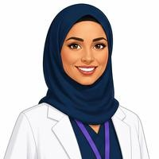

# Visual and audio asset register — 03 Welcome On Board

Production hand-off for review (storyboard **v0.2**, 2026-10-14). Built from the **Imagery** tables in [`storyboard.md`](storyboard.md); the Phase 3 manifest is in [`../phase-3-narration-and-assets.md`](../phase-3-narration-and-assets.md) §4. `Generated` means the file exists (in the repo or in My Clinic's Canva account); `planned` means it must still be made, captured or approved. Every asset still needs its `add_asset` provenance record in Phase 4. No asset was generated in this module pack.

## 1. Shared programme companions (Noor and Dr. Omar)

Shared art from [`companions.md`](../../00_program/characters/companions.md) §3 — **no module-specific character art and no character AI prompts in this module**. Full-size originals are in My Clinic's Canva account (`https://www.canva.com/M/<media id>`); download as transparent PNG into `00_program/characters/assets/<asset id>.png`. Low-resolution previews: [`../../00_program/characters/previews/`](../../00_program/characters/previews/).

| Asset id | Preview | Canva media id | Screens | Placement | Status | Alt text |
|---|---|---|---|---|---|---|
| `char-noor-avatar-concern` |  | — (crop from char-noor-concern (MAHX-hFE0aQ)) | `hr-031` | `hr-031` L5 avatar | to make (crop, companions.md §3) | “Noor, the safety liaison, looking concerned.” |
| `char-noor-avatar-happy` |  | — (crop from char-noor-success (MAHX-jiR90M)) | `hr-031`, `hr-091` | `hr-031` L5 avatar; `hr-091` L6 | to make (crop, companions.md §3) | “Noor, the safety liaison, smiling.” |
| `char-noor-avatar-neutral` |  | `MAHX-n4HuyU` | `hr-031`, `hr-044` | `hr-031` L5 avatar; `hr-044` L5 avatar | generated (Canva AI, 14 Oct 2026); download transparent PNG | “Noor, the safety liaison, listening.” |
| `char-noor-welcome` |  | `MAHX-pFaNMU` | `hr-000` | `hr-000` L1 duo, bottom-right (mockup 07) | generated (Canva AI, 14 Oct 2026); download transparent PNG | “Noor, a senior nurse and patient-safety liaison, smiling and waving hello.” |
| `char-omar-avatar-neutral` |  | `MAHX-nPHDkA` | `hr-061` | `hr-061` L4 feedback avatar / tip after the simulation | generated (Canva AI, 14 Oct 2026); download transparent PNG | “Dr. Omar, a family physician, giving a tip.” |
| `char-omar-explaining` |  | `MAHX-ljvFtE` | `hr-001` | `hr-001` L3 right column, half-body | generated (Canva AI, 14 Oct 2026); download transparent PNG | “Dr. Omar, a family physician, presenting the clinic's purpose, mission and goal.” |
| `char-omar-listening` |  | `MAHX-uifxtY` | `hr-002` | `hr-002` L3 small, beside the poll | generated (Canva AI, 14 Oct 2026); download transparent PNG | “Dr. Omar, a family physician, listening with a tablet in his hand.” |
| `char-omar-success` |  | `MAHX-llCU5M` | `hr-091` | `hr-091` L6 | generated (Canva AI, 14 Oct 2026); download transparent PNG | “Dr. Omar, a family physician, smiling and giving a thumbs up.” |
| `char-omar-thinking` |  | `MAHX-jgu1Vk` | `hr-043` | `hr-043` L3 right column | generated (Canva AI, 14 Oct 2026); download transparent PNG | “Dr. Omar, a family physician, thinking through the example.” |
| `char-omar-welcome` |  | `MAHX-hEFOR4` | `hr-000` | `hr-000` L1 duo, bottom-right (mockup 07) | generated (Canva AI, 14 Oct 2026); download transparent PNG | “Dr. Omar, a family physician, smiling and waving hello.” |

Companion screens: 8 of 36 (`hr-000`, `hr-001`, `hr-002`, `hr-031`, `hr-043`, `hr-044`, `hr-061`, `hr-091`) — exactly the Phase 3 “Companions in this module” table. `char-duo-welcome` on `hr-000` is the two `-welcome` poses side by side, not a separate image.

## 2. Supplied My Clinic brand assets

| Asset id | Kind | Screens | File | Alt text | Decorative? |
|---|---|---|---|---|---|
| `brand-background-title-navy` | background | `hr-000` | [`background-title-navy.png`](../../00_program/brand/assets/background-title-navy.png) | Decorative background. | Yes |
| `brand-logo-horizontal-white` | image | `hr-000` | [`logo-horizontal-white.png`](../../00_program/brand/assets/logo-horizontal-white.png) | My Clinic logo. | No |
| `brand-mark-white` | icon | `hr-000` | [`mark-white.png`](../../00_program/brand/assets/mark-white.png) | Decorative watermark. | Yes |
| `brand-value-tile-ambitious-teal` | image | `hr-010` | [`value-tile-ambitious-teal.png`](../../00_program/brand/assets/value-tile-ambitious-teal.png) | Decorative; the tab label carries the value name. | Yes |
| `brand-value-tile-caring-purple` | image | `hr-010` | [`value-tile-caring-purple.png`](../../00_program/brand/assets/value-tile-caring-purple.png) | Decorative; the tab label carries the value name. | Yes |
| `brand-value-tile-collaborative-burgundy` | image | `hr-010` | [`value-tile-collaborative-burgundy.png`](../../00_program/brand/assets/value-tile-collaborative-burgundy.png) | Decorative; the tab label carries the value name. | Yes |
| `brand-value-tile-responsible-magenta` | image | `hr-010` | [`value-tile-responsible-magenta.png`](../../00_program/brand/assets/value-tile-responsible-magenta.png) | Decorative; the tab label carries the value name. | Yes |

Every other screen uses the supplied `logo-horizontal-navy.png` in the 64 px header (not repeated per screen above).

## 3. Module assets (planned)

| Asset id | Kind | Screens | Brief | Source route | Alt text | Status |
|---|---|---|---|---|---|---|
| `hr-img-7c-icons` | SVG ×7 | `hr-012` | Line icons redrawn from slide 10: headset (Closer), syringe (Cure), mind-and-gears (Capabilities), handshake (Culture), stethoscope (Clinicians), heart-hands (Care), coins (Cost) | own | Decorative — each panel is labelled in text. | planned — to produce |
| `hr-img-serve-icons` | SVG ×3 | `hr-014` | Line icons: family group, community ring, briefcase-and-shield | own | Decorative — each card is labelled in text. | planned — to produce |
| `hr-img-map` | SVG | `hr-021` | 1200×800, simplified outline of the western region plus a Riyadh inset; no satellite detail; seven pin positions marked but pin graphics drawn by the player | own | Map of My Clinic sites: five in Jeddah, one in Petro-Rabigh, one in Riyadh. | planned — to produce |
| `hr-img-leaders-ceo` | photo | `hr-022` | Consented portrait, 800×800, neutral studio background | local (consent on file — B6) | “Abdullah Alghamdi, Chief Executive Officer.” | blocked on **B6 / D5** (consent); monogram fallback |
| `hr-img-leaders-cmo` | photo | `hr-022` | Consented portrait, 800×800 | local (consent on file — B6) | “Dr Ahmed Al Zahrani, Chief Medical Officer.” | blocked on **B6 / D5** (consent); monogram fallback |
| `hr-img-leaders-coo` | photo | `hr-022` | Consented portrait, 800×800 | local (consent on file — B6) | “Hesham Abdulwahab, Chief Operating Officer.” | blocked on **B6 / D5** (consent); monogram fallback |
| `hr-img-leaders-cfo` | photo | `hr-022` | Consented portrait, 800×800 | local (consent on file — B6) | “Richard Thompson, Chief Finance Officer.” | blocked on **B6 / D5** (consent); monogram fallback |
| `hr-img-award-icons` | SVG ×2 | `hr-023` | Two line icons redrawn from slides 17–18: a trophy and a laurel star | own | Decorative — each card front is labelled in text. | planned — to produce |
| `hr-img-ethics-icons` | SVG ×4 | `hr-030` | Line icons: two people with a heart (Respect), open hand with a tick (Integrity), clipboard with a check (Accountability), lightbulb with a link (Innovation and collaboration) | own | Decorative — each value is labelled in text. | planned — to produce |
| `hr-img-ethics-meeting` | illustration | `hr-031` | Flat meeting-room scene: table, four chairs, a laptop and a document; two brand colours | ai-generated | “A small meeting room where a supplier evaluation is being discussed.” | planned — to produce; AI image prompt in the card (no people who resemble the companions, no text, no logos) |
| `hr-img-ethics-corridor` | illustration | `hr-031` | Flat corridor scene: reception desk and a queue of two patients | ai-generated | “A clinic corridor with a reception desk and two patients waiting.” | planned — to produce; AI image prompt in the card (no people who resemble the companions, no text, no logos) |
| `hr-img-ethics-desk` | illustration | `hr-031` | Flat desk scene: laptop showing a blank report form, a cup, a notebook | ai-generated | “A desk with a laptop open on an incident report form.” | planned — to produce; AI image prompt in the card (no people who resemble the companions, no text, no logos) |
| `hr-img-help-icons` | SVG ×3 | `hr-040` | Line icons: headset (help desk), screen-and-form (Oracle), document-arrow (PDF) | own | Decorative — each card is labelled in text. | planned — to produce |
| `hr-pdf-quickref` | PDF | `hr-040`, `hr-091` | 2 pages: leave tables, pay and GOSI, overtime, contacts. Written by HR from confirmed policy. | own | n/a (linked resource, not an image) | HR writes from confirmed policy |
| `hr-img-leavedesk` | illustration | `hr-044` | Flat office-desk scene: a desk, a laptop, a small plant, two chairs; brand colours, white background | ai-generated | “An HR service desk with a laptop and two chairs.” | planned — to produce; AI image prompt in the card (no people who resemble the companions, no text, no logos) |
| `hr-img-gosi-bar` | SVG | `hr-050` | 960×200 authored SVG stacked bar, two segments; percentages as real text, not baked in | own | “GOSI contribution: the employee pays 9.75%, My Clinic pays 11.75%, a total of 21.5%.” | planned — to produce |
| `hr-img-oracle-1` | screenshot | `hr-061` | Oracle Applications Cloud sign-in page, test account, 1920×1080 | own (test account — B8) | “Oracle sign-in page with empty username and password fields and a Sign In button.” | blocked on **B8** (test-account captures) |
| `hr-img-oracle-2` | screenshot | `hr-061` | Oracle home with the Time and Absences tile | own (test account — B8) | “Oracle home page with a Time and Absences tile in the quick actions area.” | blocked on **B8** (test-account captures) |
| `hr-img-oracle-3` | screenshot | `hr-061` | Time and Absences hub with the Add Leaves tile | own (test account — B8) | “Oracle Time and Absences page with an Add Leaves tile.” | blocked on **B8** (test-account captures) |
| `hr-img-oracle-4` | screenshot | `hr-061` | Add Leaves form with the leave-type drop-down open, showing Annual, Bereavement, Marriage, Scientific, Sick, Study | own (test account — B8) | “Oracle Add Leaves form with the leave-type drop-down open.” | blocked on **B8** (test-account captures) |
| `hr-img-oracle-5` | screenshot | `hr-061` | Add Leaves form filled, with a Submit button | own (test account — B8) | “Oracle Add Leaves form with dates entered and a Submit button.” | blocked on **B8** (test-account captures) |
| `hr-img-idcard` | illustration | `hr-070` | Flat ID badge on a lanyard, first name only, no real logo until approved | ai-generated | “A My Clinic staff ID badge on a lanyard.” | planned — to produce; AI image prompt in the card (no people who resemble the companions, no text, no logos) |
| `hr-img-benefits-wheel` | SVG | `hr-070` | 600×600 six-segment wheel: health insurance, performance bonus, development, hybrid work, internal advancement, discounts; labels as real text | own | “Benefits wheel: health insurance, annual performance bonuses, employee development, hybrid work, internal advancement and discounts.” | planned — to produce |
| `hr-img-dress-frontoffice` | illustration | `hr-071` | Flat figure in a clinic uniform, standing, neutral background | ai-generated | “A front-office colleague in the clinic uniform.” | planned — to produce; AI image prompt in the card (no people who resemble the companions, no text, no logos) |
| `hr-img-dress-medical` | illustration | `hr-071` | Flat figure in scrubs and a coat, with a stethoscope | ai-generated | “A clinical colleague in scrubs and a coat.” | planned — to produce; AI image prompt in the card (no people who resemble the companions, no text, no logos) |
| `hr-img-dress-backoffice` | illustration | `hr-071` | Flat figure in business attire | ai-generated | “A back-office colleague in business attire.” | planned — to produce; AI image prompt in the card (no people who resemble the companions, no text, no logos) |
| `hr-img-exit-icons` | SVG ×4 | `hr-080` | Line icons: document-signature (Qiwa), screen-and-form (Oracle), calendar (notice period), envelope-with-certificate (EOS) | own | Decorative — each step is labelled in text. | planned — to produce |

Phase 3 manifest reconciliation: `hr-img-hero` (consented team photo) is **not placed** in v0.2 — Dr. Omar's `char-omar-explaining` pose took the right column of `hr-001` (storyboard proposed change 3); `hr-img-branches` (branch photos inside the `hr-021` pin cards) stays optional until rights are confirmed (B6 / D5); `hr-img-values-icons` is replaced by the supplied value tiles on `hr-010`.

## 4. Audio

| Item | Detail |
|---|---|
| Script | [`narration-script.json`](narration-script.json) — 39 lines for 36 screens: Dr. Omar 35, Noor 4 |
| Recording hand-off | [`voice_talent.md`](voice_talent.md) and [`audio-script-export.json`](audio-script-export.json) (`tts_text` with labels removed and lexicon applied, `ssml`, per-line `filename`, per-screen `screen_file`) |
| Two-voice screens | `hr-000`, `hr-091`: record `omar-1` and `noor-1`, join with 0.3 s silence, run `normalize_audio_asset` |
| Feedback clip | `hr-061` `omar-tip`, played with the end-of-simulation tip card |
| Voices | Dr. Omar and Noor — provider and voice ids pending program **D10**; approve a 30-second sample of each first |
| Reference clips | [`audio/`](audio/) holds 10 v0.1 single-voice reference reads — **superseded**, not the companion voices; do not ship |

## 5. Non-negotiable production rules

- Use the supplied My Clinic logo PNGs; never generate, redraw or bake the logo into an AI image.
- Companions come only from the approved programme masters (`char-noor-*`, `char-omar-*`); never generate a module-specific Noor or Omar, and keep badges blank.
- AI images contain no text, letters, numbers, brand names or patient/staff likenesses, and generic staff figures must not resemble the companions. Review every generated image before it becomes an interaction asset.
- Oracle screenshots come from a test account only (B8); no real employee names or data.
- Keep diagrams as SVG/HTML where factual text needs revision after SME review.
